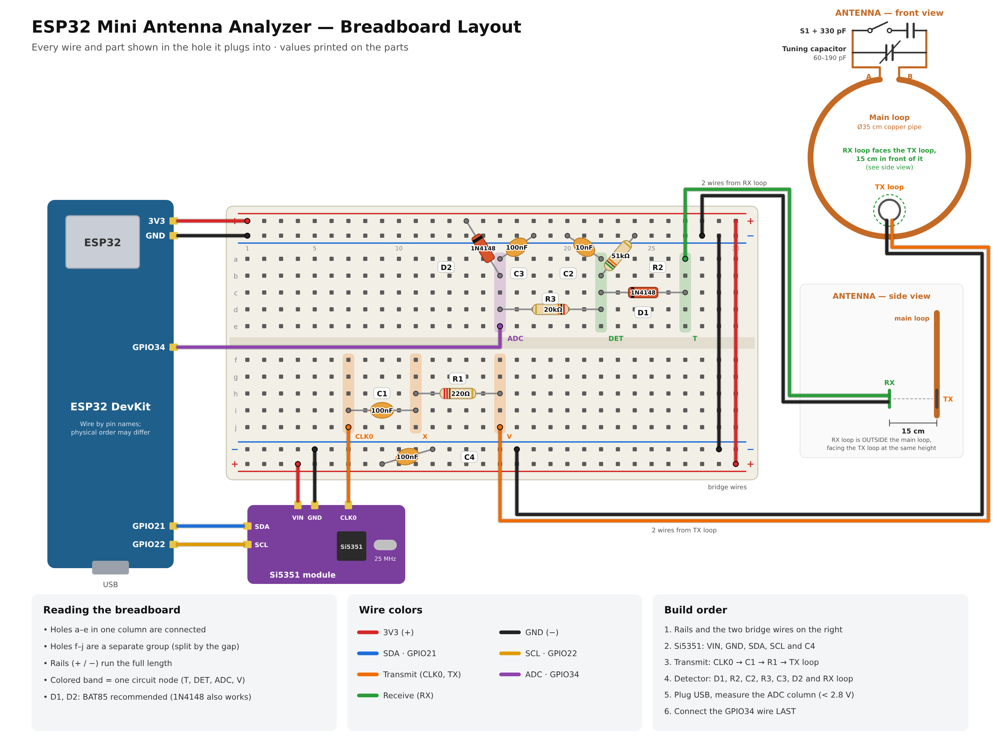

# ESP32 Mini Antenna Analyzer — finding the resonance of a homemade magnetic loop

[Türkçe](README.tr.md)

*Keywords: magnetic loop antenna, small transmitting/receiving loop, resonance, ESP32, Si5351,
poor man's NanoVNA, antenna analyzer, shortwave, SDR, DIY, homebrew.*

I found the resonance of my **copper-pipe magnetic loop antenna** with a **homemade mini antenna
analyzer** built from parts I had: an ESP32, a Si5351 and a few resistors, capacitors and diodes.
A live graph in the browser shows the antenna's resonance "peak".

> It's not a NanoVNA. It is a **very simple homemade version of the idea**: it finds the resonance
> *approximately* and shows how it moves with the tuning knob. It does not measure SWR,
> impedance or efficiency.

| ▶ Video walkthrough (Turkish) | Resonance peak |
|---|---|
|  |  |

## The real build

| Antenna | Analyzer (breadboard) |
|---|---|
|  |  |

| Homemade tuning capacitor (copper-clad boards) | Switch S1 + 330 pF |
|---|---|
|  |  |

## How it works

- **Big copper loop + tuning capacitor** = a resonant circuit, like a swing that only goes high
  at its own rhythm. The knob changes that rhythm (frequency).
- **TX loop** (small): the Si5351 sweeps a weak test signal through it → a changing magnetic field.
- **RX loop** (small): picks the field up. At its resonant frequency the big loop "rings" and
  carries the signal → the RX loop receives more there.
- A **diode detector** turns the RF into a DC voltage, the ESP32 reads it while sweeping, and the
  web page plots it.
- Nothing touches: the signal goes through the air by **mutual induction** (like a wireless charger).

## Build

👉 **Step-by-step guide: [docs/BUILD.md](docs/BUILD.md)** (Turkish: [docs/KURULUM.md](docs/KURULUM.md))

| Schematic | Breadboard |
|---|---|
|  |  |

## Repository

| Path | Content |
|---|---|
| `firmware/ANTEN_TEST/` | ESP32 firmware (Arduino, ESP32 Dev Module, core 2.0.14) |
| `web/canli-grafik.html` | Live graph page (Chrome/Edge, no install, Web Serial over USB; UI in Turkish) |
| `docs/BUILD.md` · `docs/KURULUM.md` | Step-by-step build (EN / TR) |
| `docs/img/semalar/` | Schematic and breadboard drawings (SVG + PNG, EN + TR) |
| `docs/img/olcumler/` | Screenshots of the measurements that found the resonance |
| `docs/img/ilk-deneme/` | Screenshots of the first method that did not work |

## What happened

1. **I bought a potentiometer instead of a variable capacitor.** So I made my own variable
   capacitor from **copper-clad boards**: **60–190 pF** measured (the design wanted 10–360 pF). Narrow, but enough for testing.
2. **To measure it, I repaired my LCR-T4 tester** (broken screen, LGT8F328P inside, now with an OLED):
   [LCR-T4-display-replacement-OLED](https://github.com/altunsumerve/LCR-T4-display-replacement-OLED).
3. **The antenna handle is a Pringles can.** The bottom of the 35 cm loop goes through the can,
   so the antenna stands on the table like a torch.
4. **First attempt failed: one loop (reflection method).** One small loop both sent and listened.
   The graph was **flat** (~970) and did **not change** even with the loop moved 30 cm away. The
   reading didn't come from the antenna; the transmitter drowned the antenna's weak "echo".
5. **Second attempt: two loops.** One loop talks (TX), one listens (RX). But some of the TX signal
   reaches the RX loop directly and hid the peak.
6. **Solution: subtract a reference.** With switch S1 off, the antenna's resonance is outside the
   6–8 MHz sweep window. I saved that curve as a **reference**. With S1 on, the page shows only the
   **difference**, and the big loop appeared as a peak at **~7.62 MHz**. That matches the calculated
   range (S1 on: 7.2–8.3 MHz). 🎉

| One loop: flat | Zoomed | Loop moved away: no change |
|---|---|---|
|  |  |  |

## Measurements

| # | What | Screenshot |
|---|---|---|
| 1 | Two loops, first raw sweep (7–8 MHz, 20 kHz) | [01](docs/img/olcumler/01-iki-halka-ilk-tarama.png) |
| 2 | S1 off, raw sweep | [02](docs/img/olcumler/02-anahtar-kapali-tarama.png) |
| 3 | Fine sweep (5 kHz step) | [03](docs/img/olcumler/03-ince-tarama-5khz.png) |
| 4 | Reference saved with S1 off | [04](docs/img/olcumler/04-referans-kaydedildi.png) |
| 5 | Reference subtracted → flat around zero | [05](docs/img/olcumler/05-referans-cikarildi-duz.png) |
| 6 | S1 on → difference starts to appear | [06](docs/img/olcumler/06-anahtar-baglandi.png) |
| 7 | S1 on, fine sweep + average of 8 sweeps → **clear peak at ~7.62 MHz** | [07](docs/img/olcumler/07-rezonans-tepesi-7-62MHz.png) |
| 8 | Tuning knob turned → peak moved to **~7.29 MHz** | [08](docs/img/olcumler/08-dugme-cevrildi-7-29MHz.png) |
| 9 | Knob turned further → **~7.14 MHz** | [09](docs/img/olcumler/09-dugme-cevrildi-7-14MHz.png) |
| 10 | Knob turned further → **~7.07 MHz** (peak near the left edge of the window) | [10](docs/img/olcumler/10-dugme-cevrildi-7-07MHz.png) |

**The peak follows the tuning knob:** ~7.62 → 7.29 → 7.14 → 7.07 MHz. That's the best evidence that the peak is the big loop's resonance.

| 7.62 MHz | 7.29 MHz | 7.07 MHz |
|---|---|---|
|  |  |  |

The numbers are raw ADC differences, not power, SWR or efficiency.

## Can anyone test their own antenna with it?

**Partly, yes.** The setup finds the resonance of **small (magnetic) loop antennas and tuned LC circuits**: place the TX and RX
loops next to the antenna, sweep, and the peak shows where it is tuned.

| Good for | Not for |
|---|---|
| Magnetic / small loop antennas | **SWR** of dipoles, long wires, verticals |
| Ferrite rod antennas, tuned coil + capacitor circuits | Impedance, efficiency, loss |
| "Where is the resonance, where does the knob move it?" | Exact, calibrated frequency (NanoVNA territory) |

**Frequency limit:** the firmware is limited to **6–8 MHz** (`MIN_HZ`/`MAX_HZ` in `scan_config.h`). The Si5351 can do far more;
widening the limit is a small firmware change, but other bands haven't been tested yet.

## Limits and next steps

- A relative test: the peak is the *approximate* resonance. Firmware limited to 6–8 MHz.
- With the 60–190 pF homemade capacitor the antenna doesn't cover 8.3–11.8 MHz or above 20 MHz.
  A wider homemade variable capacitor (e.g. from soda-can plates) is planned.
- BAT85 diodes are more sensitive; this build used 1N4148.
- **Phone (NFC) test not tried yet.** The firmware and page have a "listen" mode (`listen`, "Telefonu dinle"):
  transmitter off, catching a phone's 13.56 MHz NFC signal with the antenna. No result yet.
- Next: listening to real stations with this antenna on an SDR receiver.

## License

GPL-3.0-or-later ([LICENSE](LICENSE)). Si5351 driver:
[Etherkit Si5351Arduino](https://github.com/etherkit/Si5351Arduino) (GPL-3.0).
