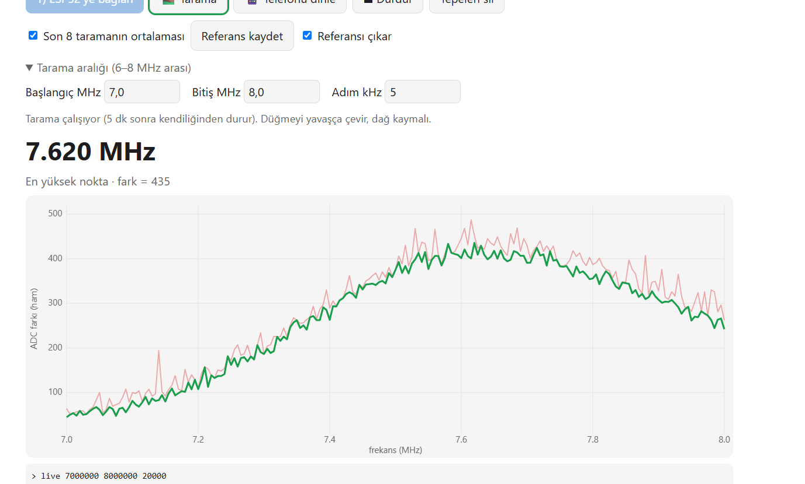
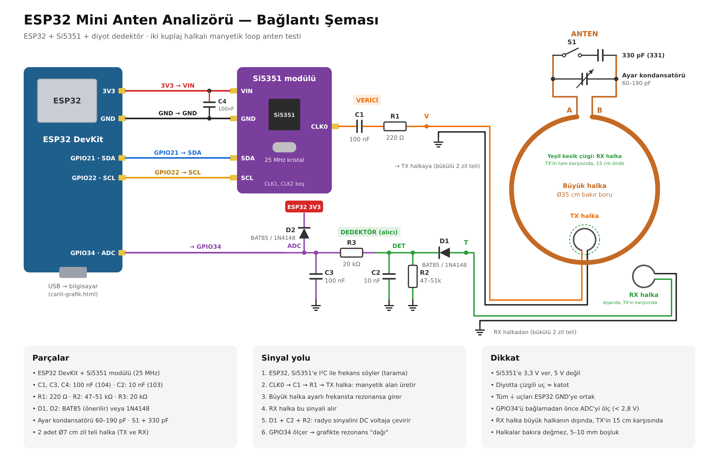
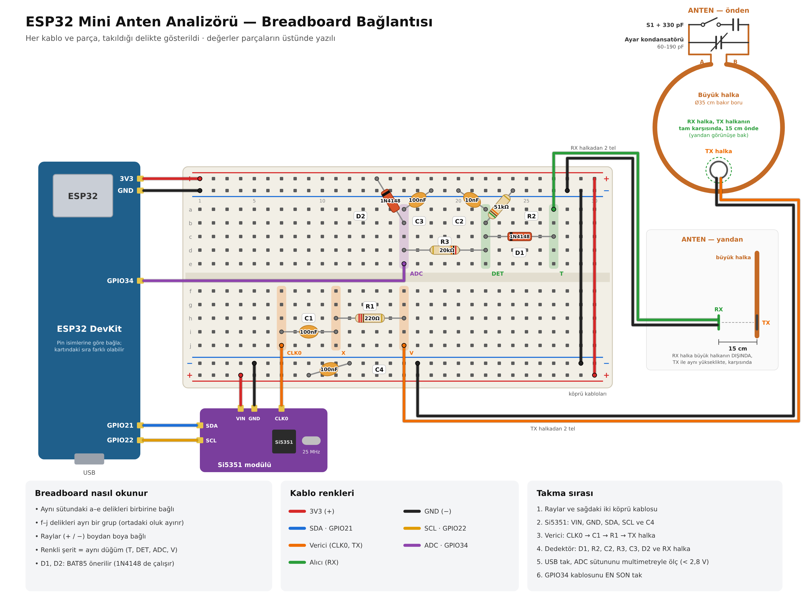
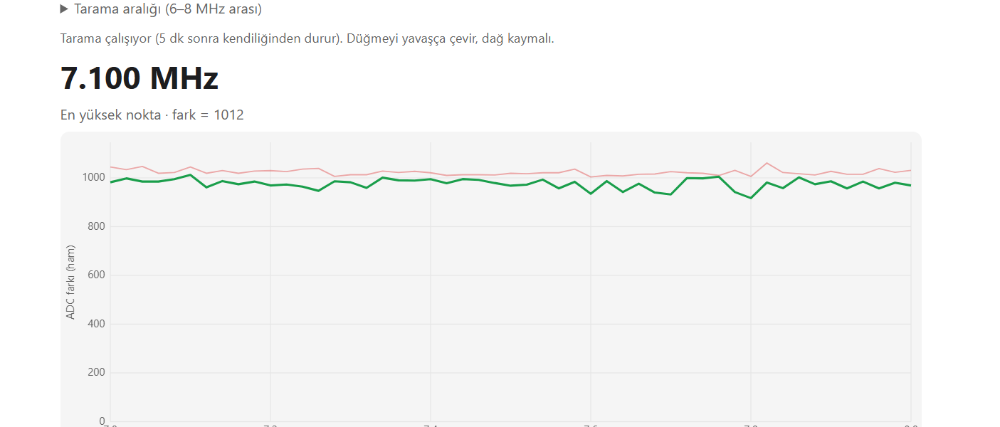
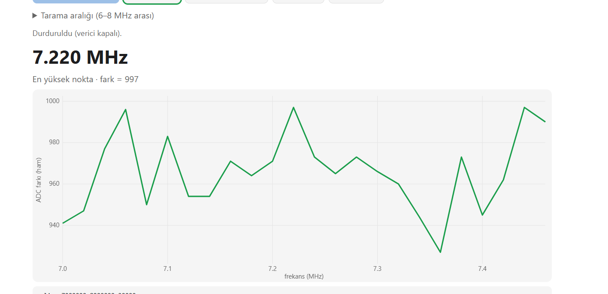
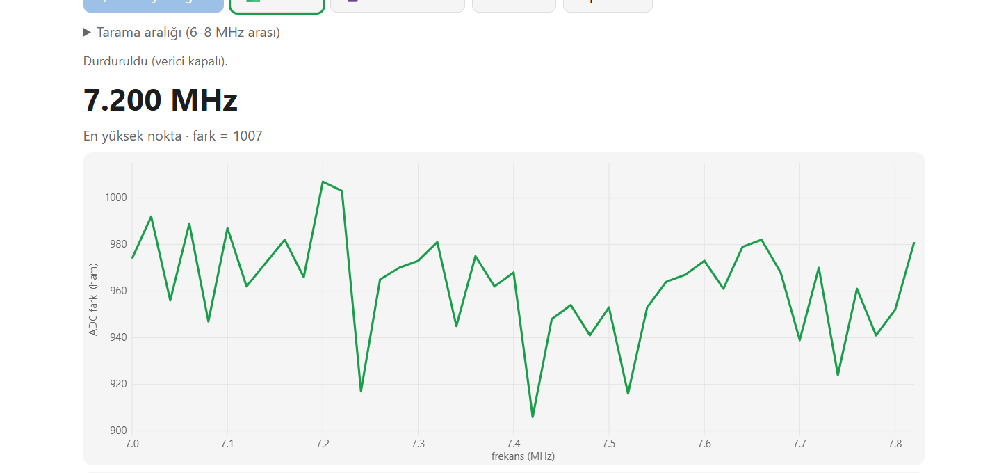
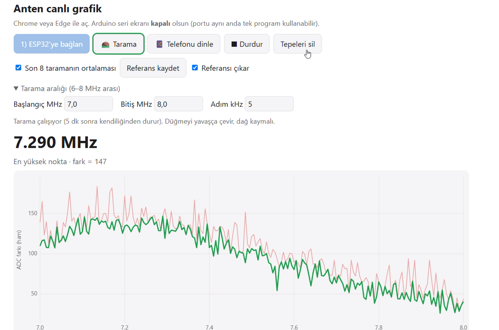
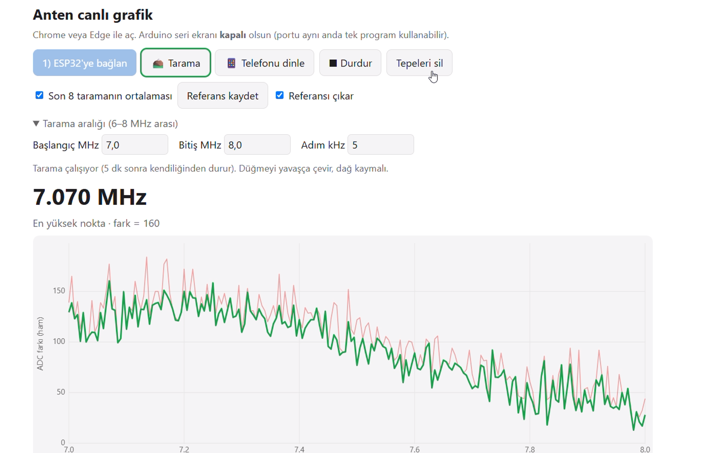

# ESP32 Mini Anten Analizörü — ev yapımı manyetik halka anten testi

[English](README.md)

*Anahtar kelimeler: manyetik loop anten, halka anten, rezonans, ESP32, Si5351, NanoVNA'nın basit hâli,
anten analizörü, kısa dalga, SDR, kendin yap.*

Bakır borudan yaptığım **manyetik halka antenin** rezonansını, elimdeki parçalarla yaptığım
**ev yapımı mini anten analizörüyle** buldum: ESP32 + Si5351 + birkaç direnç, kondansatör ve diyot.
Bilgisayardaki canlı grafikte antenin "dağını" görüyorum.

> NanoVNA değil, **onun çok basit bir ev yapımı versiyonu**: antenin rezonansını *yaklaşık* bulur
> ve ayar düğmesiyle nasıl kaydığını gösterir. SWR, empedans ya da verim ölçmez.

| ▶ Videolu anlatım | Rezonans tepesi |
|---|---|
|  |  |

## Gerçek düzenek

| Anten | Analizör (breadboard) |
|---|---|
|  |  |

| Ev yapımı ayar kondansatörü (bakır plaketler) | S1 anahtarı + 330 pF |
|---|---|
|  |  |

## Nasıl çalışıyor? (sade hâliyle)

- **Büyük bakır halka + ayar kondansatörü** bir salıncak gibi: yalnız kendi "ritminde" (rezonans
  frekansında) güçlü sallanır. Ayar düğmesi bu ritmi değiştirir.
- **TX halka** (küçük, verici): Si5351'in ürettiği zayıf test sinyalini görünmez bir mıknatıs
  alanına çevirir.
- **RX halka** (küçük, alıcı): bu alanı dinler. Büyük halka ayarlı olduğu frekansta "çınlar" ve
  sinyali taşır → RX halka o frekansta daha çok duyar.
- **Diyot dedektör** radyo sinyalini ESP32'nin okuyabileceği bir voltaja çevirir; ESP32 frekansları
  tarar, bilgisayardaki sayfa grafiği çizer.
- Halkalar birbirine değmez; sinyal havadan geçer (**karşılıklı indüksiyon** — kablosuz şarj
  aletinin mantığı).

## Kurulum

👉 **Adım adım rehber: [docs/KURULUM.md](docs/KURULUM.md)** (hangi kablo nereye, kontroller,
yazılım, rezonansı bulma yöntemi)

| Bağlantı şeması | Breadboard |
|---|---|
|  |  |

## Depo içeriği

| Yol | İçerik |
|---|---|
| `firmware/ANTEN_TEST/` | ESP32 yazılımı (Arduino, ESP32 Dev Module, çekirdek 2.0.14) |
| `web/canli-grafik.html` | Canlı grafik sayfası (Chrome/Edge, kurulum gerektirmez — USB üzerinden Web Serial) |
| `docs/KURULUM.md` · `docs/BUILD.md` | Adım adım kurulum (TR / EN) |
| `docs/img/semalar/` | Bağlantı şeması ve breadboard çizimleri (SVG + PNG, TR + EN) |
| `docs/img/olcumler/` | Rezonansı bulduğum ölçümlerin ekran görüntüleri |
| `docs/img/ilk-deneme/` | İşe yaramayan ilk yöntemin ekran görüntüleri |

## Yaşadıklarım

**1. Ayarlı kondansatör yerine potansiyometre almıştım.** Anten için 10–360 pF'lık bir değişken
kondansatör gerekiyordu; yanlışlıkla potansiyometre aldım (o bir direnç, işe yaramaz).
**Bakır plaketlerden** kendim bir değişken kondansatör yaptım: ölçtüğümde **60–190 pF** verdi. Olması gerekenden dar,
ama testler için yeterli.

**2. Kondansatörü ölçmek için LCR-T4'ü tamir ettim.** Test cihazımın ekranı kırıktı; içinden
ATmega değil LGT8F328P çıktı, OLED ekran taktım ve yazılımını uyarladım:
[LCR-T4-display-replacement-OLED](https://github.com/altunsumerve/LCR-T4-display-replacement-OLED).

**3. Anten: Pringles kutusu sap oldu.** 35 cm'lik bakır halkanın alt kısmını bir Pringles
kutusunun içinden geçirdim; anten bir meşale gibi elde tutuluyor ve masada dik duruyor.

**4. İlk deneme başarısız oldu: tek halka (yansıma) yöntemi.** Önce tek küçük halkayla hem sinyal
gönderip hem dinledim. Grafik **düz bir çizgi** çıktı (~970) ve küçük halkayı 30 cm uzaklaştırınca
bile **değişmedi** → ölçtüğüm şey antenden gelmiyordu. Vericinin kendi sinyali, antenin zayıf
"yankısını" bastırıyordu.

| Düz çizgi | Yakınlaştırılmış | Halka uzaklaştırıldı — değişmedi |
|---|---|---|
|  |  |  |

**5. İkinci deneme: iki halka.** Bir halka konuşuyor (TX), diğeri dinliyor (RX). Ama TX'ten RX'e
sinyalin bir kısmı doğrudan da geliyordu; dağ bu sızıntının içinde kayboluyordu.

**6. Çözüm: referansı çıkarmak.** Anahtar (S1) kapalıyken antenin rezonansı tarama penceresinin
dışında kalıyor. Bu durumda grafiği **referans** olarak kaydettim; anahtarı açınca grafik sadece
**farkı** gösterdi → büyük halkanın katkısı bir tepe olarak ortaya çıktı: **~7,62 MHz**.
Hesapladığım aralıkla (S1 açık: 7,2–8,3 MHz) uyumlu. 🎉

## Ölçüm sonuçları

| # | Ne yapıldı | Görüntü |
|---|---|---|
| 1 | İki halka, ilk ham tarama (7–8 MHz, 20 kHz) | [01](docs/img/olcumler/01-iki-halka-ilk-tarama.png) |
| 2 | S1 kapalı, ham tarama | [02](docs/img/olcumler/02-anahtar-kapali-tarama.png) |
| 3 | İnce tarama (5 kHz adım) | [03](docs/img/olcumler/03-ince-tarama-5khz.png) |
| 4 | S1 kapalıyken referans kaydedildi | [04](docs/img/olcumler/04-referans-kaydedildi.png) |
| 5 | Referans çıkarıldı → düz (sıfır civarı) | [05](docs/img/olcumler/05-referans-cikarildi-duz.png) |
| 6 | S1 açıldı → fark ortaya çıkmaya başladı | [06](docs/img/olcumler/06-anahtar-baglandi.png) |
| 7 | S1 açık, ince tarama + 8 tarama ortalaması → **~7,62 MHz'te belirgin tepe** | [07](docs/img/olcumler/07-rezonans-tepesi-7-62MHz.png) |
| 8 | Ayar düğmesi çevrildi → tepe **~7,29 MHz**'e kaydı | [08](docs/img/olcumler/08-dugme-cevrildi-7-29MHz.png) |
| 9 | Düğme biraz daha çevrildi → **~7,14 MHz** | [09](docs/img/olcumler/09-dugme-cevrildi-7-14MHz.png) |
| 10 | Düğme biraz daha çevrildi → **~7,07 MHz** (tepe pencerenin sol kenarına yaklaştı) | [10](docs/img/olcumler/10-dugme-cevrildi-7-07MHz.png) |

**Ayar düğmesiyle tepe kayıyor:** ~7,62 → 7,29 → 7,14 → 7,07 MHz. Tepenin büyük halkanın rezonansı olduğunun en güzel kanıtı bu.

| 7,62 MHz | 7,29 MHz | 7,07 MHz |
|---|---|---|
|  |  |  |

Sayılar ham ADC farkıdır; güç, SWR ya da verim değildir.

## Herkes kendi antenini test edebilir mi?

**Kısmen evet.** Bu düzenek, **küçük halka (manyetik loop) antenlerin ve ayarlı LC devrelerinin** rezonansını bulmak için uygun:
TX ve RX halkalarını antenin yanına koyup tarama yapıyorsun, tepe antenin ayarlı olduğu yeri gösteriyor.

| Uygun | Uygun değil |
|---|---|
| Manyetik loop / halka antenler | Dipol, uzun tel, dikey antenlerin **SWR** ölçümü |
| Ferrit çubuk antenler, ayarlı bobin+kondansatör devreleri | Empedans, verim, kayıp ölçümü |
| "Rezonans nerede, düğmeyle nereye kayıyor?" sorusu | Kesin frekans/kalibre ölçüm (NanoVNA işi) |

**Frekans sınırı:** Yazılım şu an **6–8 MHz** ile sınırlı (`scan_config.h` içindeki `MIN_HZ`/`MAX_HZ`). Si5351 çok daha geniş bir
aralık üretebiliyor; sınırı genişletmek basit bir yazılım değişikliği, ama diğer frekanslarda henüz denenmedi.

## Sınırlar ve sonraki adımlar

- Göreli bir test; tepe rezonansın **yaklaşık** yeridir. Yazılım 6–8 MHz ile sınırlı.
- Ev yapımı kondansatör (60–190 pF) ile anten 8,3–11,8 MHz arasını ve 20 MHz üstünü kapsamıyor;
  daha geniş bir değişken kondansatör (ör. kola kutusu levhalarından) planlanıyor.
- D1/D2 için BAT85 daha hassas; bu projede 1N4148 kullanıldı.
- **Telefon (NFC) testi henüz denenmedi.** Yazılımda ve grafik sayfasında "Telefonu dinle" modu var (`listen`):
  verici kapalıyken telefonun 13,56 MHz NFC sinyalini antenle yakalamak için. Sonucu henüz bilinmiyor.
- Sıradaki: antenle SDR alıcısında gerçek radyo dinlemek.

## Lisans

GPL-3.0-or-later ([LICENSE](LICENSE)). Si5351 sürücüsü:
[Etherkit Si5351Arduino](https://github.com/etherkit/Si5351Arduino) (GPL-3.0).
