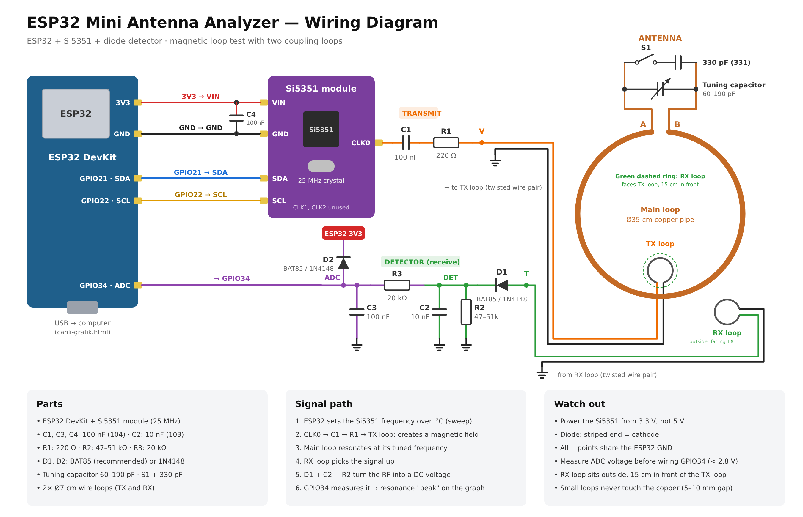
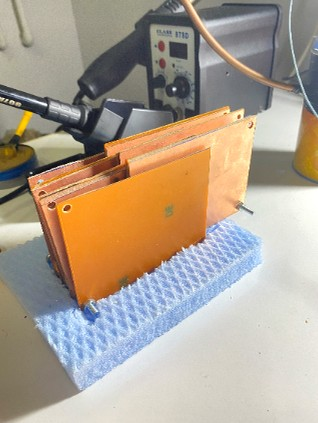
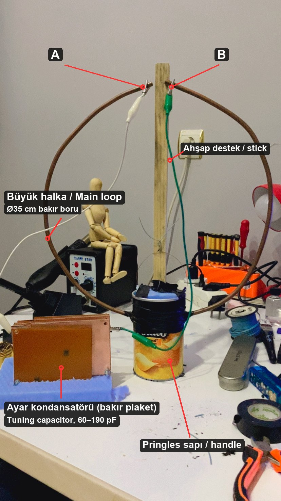
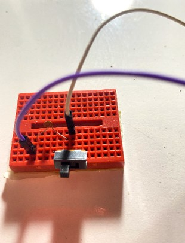
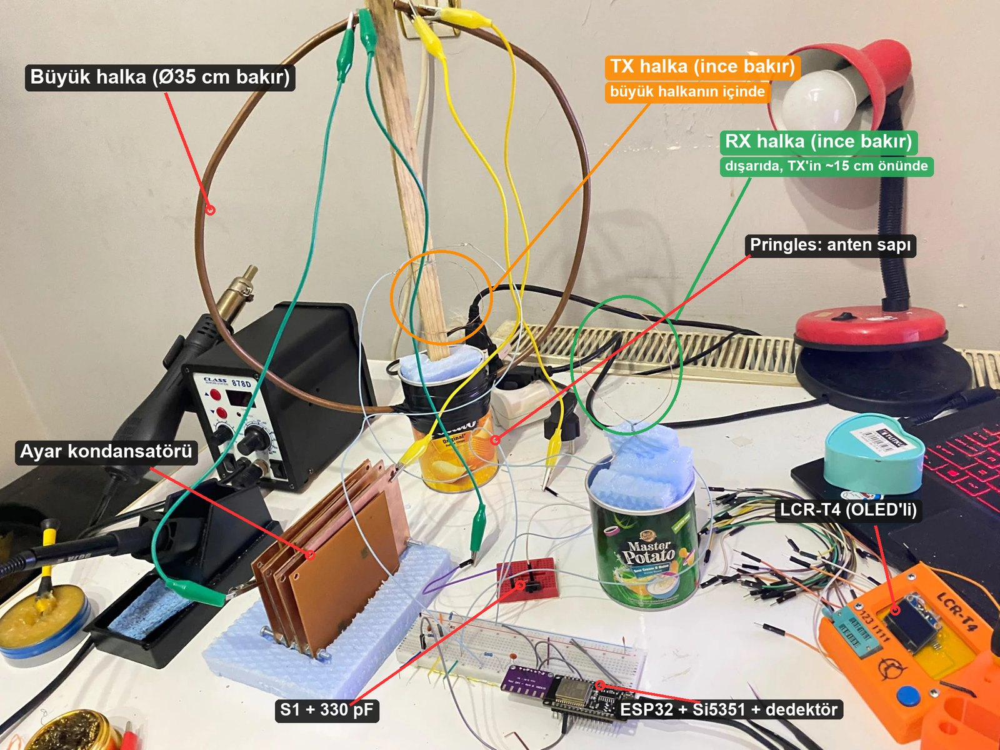
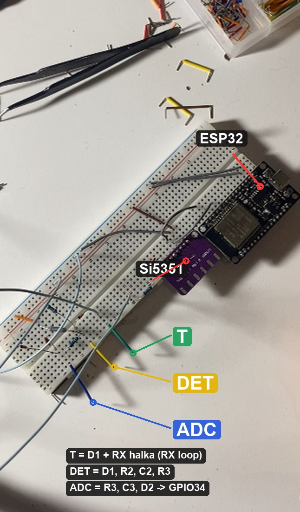

# Build guide — step by step

▶ Video walkthrough (Turkish): https://youtu.be/YRx6g13keRA

Build the copper-pipe magnetic loop and the ESP32 mini antenna analyzer, then **find the loop's
resonance**. Each section ends with a **✅ Check**; don't go on until it passes.

Schematic: [img/semalar/baglanti-semasi-en.svg](img/semalar/baglanti-semasi-en.svg) ·
Breadboard: [img/semalar/breadboard-en.svg](img/semalar/breadboard-en.svg)

---

## 0. Parts

**Antenna**

| Part | Size / note |
|---|---|
| Soft copper pipe | ~1.2 m, 6 mm (A/C pipe) |
| Tuning capacitor | Variable capacitor. Homemade here: **60–190 pF** |
| Switch S1 + fixed capacitor | Small 3-pin switch + **330 pF** ceramic (marked `331`) |
| Insulated solid wire (bell wire) | ~1.5 m (two small loops + twisted leads) |
| Handle / stand | Anything non-metallic. Here: a **Pringles can** filled with foam |

**Electronics**

| Ref | Part | Note |
|---|---|---|
| — | ESP32 DevKit | |
| — | Si5351 module | 25 MHz crystal |
| C1, C3, C4 | 100 nF | marked `104` |
| C2 | 10 nF | marked `103` |
| R1 | 220 Ω | |
| R2 | 47–51 kΩ | 51 kΩ used here |
| R3 | 20 kΩ | |
| D1, D2 | BAT85 (recommended) or 1N4148 | 1N4148 used here. **Striped end = cathode** |
| — | Breadboard, jumper wires, multimeter | |

---

## 1. Big loop (the antenna)

1. Bend the copper pipe into a **35 cm diameter** circle. Don't crush it.
2. Leave a **~1 cm gap** at the top. Call the ends **A** (left) and **B** (right).
3. Fix the loop on a non-metallic handle. Here the bottom of the loop passes through two holes in a
   **Pringles can**, which works as a torch-like handle and stand.
4. A and B must not touch; the gap must not move.

### Tuning capacitor
1. **Before connecting:** multimeter on continuity, probes on the capacitor's two leads, sweep the
   knob end to end. It must **never beep** (a beep means the plates touch).
2. Connect one lead to **A**, the other to **B**, as short as possible.

 

*The homemade capacitor here is made of copper-clad boards, clipped to A and B.*

### S1 + 330 pF
- 3-pin switch: **middle pin → A**, **one outer pin → 330 pF → B**.
- With S1 on, the 330 pF is in parallel with the tuning capacitor and the antenna tunes lower.

| S1 | Tuning range (calculated, L ≈ 0.9 µH) |
|---|---|
| Off (no 330) | ~11.8 – 19.9 MHz — **outside** the 6–8 MHz sweep window |
| On (330 in) | ~7.2 – 8.3 MHz — **inside** the window |

That difference is the key to finding the resonance (section 7).

### ✅ Check 1
- A – B (through the copper) **beeps**.
- The tuning capacitor did **not** beep across its own leads before mounting.

---

## 2. Two small loops: TX (transmit) and RX (receive)

Each: **7 cm diameter, one turn** of bell wire (wrap once around a soda can). The two ends don't
touch each other; they go to the circuit **tightly twisted together**.

| Loop | Where | Leads |
|---|---|---|
| **TX loop** | **Inside** the big loop at the **bottom**, **not touching** the copper (5–10 mm gap), same plane | end 1 → node **V** (R1 output), end 2 → **GND** |
| **RX loop** | **Outside** the big loop, **facing the TX loop, ~15 cm in front**, same height | end 1 → node **T** (D1 anode), end 2 → **GND** |

See "ANTENNA — side view" in the breadboard drawing.

*Here the TX loop sits inside the big loop next to the wooden stick; the RX loop is outside, held in foam on top of a second can.*

- No wire goes from the small loops to A/B. Coupling is through the air (mutual induction).
- Untwisted leads act as antennas themselves and spoil the measurement.

### ✅ Check 2
- Each small loop beeps end to end (it's one piece of wire, that's normal).
- Small loops vs. big loop: **no** beep.

---

## 3. Breadboard

Follow "Assembly order" on the breadboard drawing. Every connection:

### 3a. Power and rails
| From | To |
|---|---|
| ESP32 **3V3** | breadboard **+** rail |
| ESP32 **GND** | breadboard **−** rail |
| Top and bottom rails | joined by the two jumpers on the right (+ to +, − to −) |

### 3b. Si5351
| From | To |
|---|---|
| Si5351 **VIN** | **+** rail (3.3 V) — **never 5 V** |
| Si5351 **GND** | **−** rail |
| Si5351 **SDA** | ESP32 **GPIO21** |
| Si5351 **SCL** | ESP32 **GPIO22** |
| **C4** 100 nF | across Si5351 VIN–GND, close to the module |

CLK1 and CLK2 stay unconnected.

### 3c. Transmitter (TX)
| From | To |
|---|---|
| Si5351 **CLK0** | **C1** (100 nF) |
| C1 other end (node **X**) | **R1** (220 Ω) |
| R1 other end (node **V**) | **TX loop** end 1 |
| TX loop end 2 | **GND** |

### 3d. Detector (RX)
| From | To |
|---|---|
| **RX loop** end 1 | node **T** |
| RX loop end 2 | **GND** |
| T | **D1** unstriped end (anode) |
| D1 **striped** end (cathode) | node **DET** |
| DET | **R2** (47–51 kΩ) → GND |
| DET | **C2** (10 nF) → GND |
| DET | **R3** (20 kΩ) → node **ADC** |
| ADC | **C3** (100 nF) → GND |
| ADC | **D2** unstriped end; D2 **striped** end → **3V3** |
| ADC | ESP32 **GPIO34** — ⚠️ **LAST**, after the voltage check in section 5 |

**All grounds are common** (ESP32, Si5351, loop leads, R2/C2/C3).

*The real breadboard: nodes T, DET and ADC marked with short colored jumpers (green, yellow, blue).*

### ✅ Check 3 (power off, multimeter)
- 3V3 – GND: **no** beep.
- D1, D2 in diode mode: ~0.3 V (BAT85) / ~0.6 V (1N4148) one way, **OL** the other way.
- T – GND **beeps** (through the RX loop), V – GND **beeps** (through the TX loop).

---

## 4. Firmware (GPIO34 still disconnected)

1. Arduino IDE → Boards Manager → **esp32** (tested with 2.0.14).
2. Open `firmware/ANTEN_TEST/ANTEN_TEST.ino` (keep the folder together).
3. Board **ESP32 Dev Module** → Upload.
4. Serial Monitor **115200 baud**, **Newline** → `# READY; RF OFF.`
   Not there? Check Si5351 VIN, GND, SDA, SCL.

---

## 5. Voltage check — protect the ESP32

Multimeter on **DC volts**, black on GND, red on the **ADC** node:

1. Send `off` → close to 0.
2. S1 on, send `f7600000`, sweep the tuning knob end to end.
3. The reading must stay **positive and below 2.8 V**. If not, unplug USB and check the wiring.
4. `off` → unplug USB → **connect ADC to GPIO34** → plug USB back in.

---

## 6. Live graph

1. **Close** the Arduino Serial Monitor (only one program can open the port).
2. Open `web/canli-grafik.html` in **Chrome** or **Edge** (the UI is in Turkish).
3. **"1) ESP32'ye bağlan"** (connect) → pick the ESP32 port → wait for `READY`.
4. "Tarama aralığı" (sweep range): start **7.0**, end **8.0**, step **20** kHz.
5. **⛰️ Tarama** (sweep). Green = latest (averaged) sweep, faint red = peak hold.
   Keep "Son 8 taramanın ortalaması" (average of last 8 sweeps) on.

---

## 7. Finding the resonance (the method that worked)

Part of the TX signal reaches the RX loop **directly**, even without the big loop. Remove that
leakage with a **reference**:

1. **S1 off**: the resonance is outside the window (above ~12 MHz). Let it sweep a few times.
2. **"Referans kaydet"** (save reference). Keep **"Referansı çıkar"** (subtract reference) checked
   → the graph should be **flat around zero**.
3. **Turn S1 on**: now the loop resonates inside the window. The graph shows the difference from
   the reference: the big loop's contribution appears as **a peak**. The big number is its frequency.
4. **Turn the tuning knob slowly**: the peak should move left (more capacitance, lower frequency)
   or right (less capacitance).
5. If you change the range or step (e.g. 5 kHz for a fine sweep), **save the reference again with
   S1 off**: the page drops the old reference whenever the range or step changes.

**Measured here:** with S1 on, a broad peak around **7.62 MHz**; turning the knob moved it to
~7.29 → 7.14 → 7.07 MHz, consistent with the calculated window (7.2–8.3 MHz). When the peak reaches
the edge, start the sweep at 6.5 MHz to see the whole hill.

### What counts as success
- S1 off + reference subtracted → **flat**.
- S1 on → **a peak** appears.
- The tuning knob **moves** the peak.

### Limits
- Relative test. The peak is the *approximate* resonance; no SWR, impedance or efficiency.
- Firmware limited to 6–8 MHz.
- A broad peak comes from the homemade capacitor's losses, the 1N4148 threshold and the loop positions.

---

## Troubleshooting

| Symptom | Check |
|---|---|
| No `READY` | Si5351 VIN/GND/SDA/SCL, 3.3 V |
| Graph always zero | D1 direction, RX loop wiring, GPIO34 wire |
| Flat and high, doesn't change with S1 | Old single-loop wiring left? Are TX and RX separate loops? |
| Still flat after S1 on | Sweep the knob; widen the range to 6.0–8.0 MHz |
| Peak stuck at the edge | Turn the knob or shift the range |
| "Bağlanamadı" (cannot connect) | Arduino Serial Monitor still open; close it |
